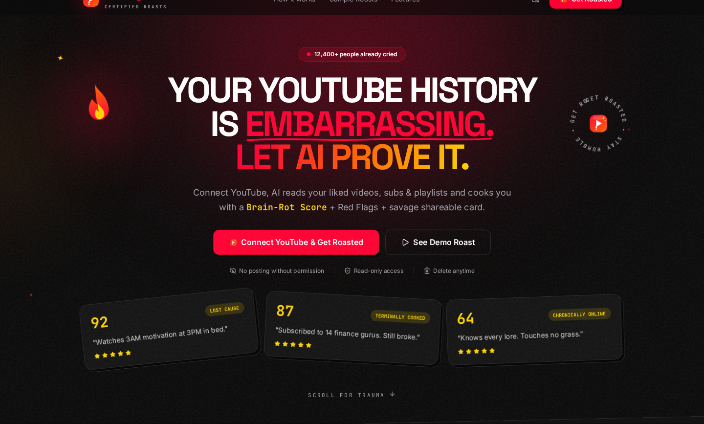
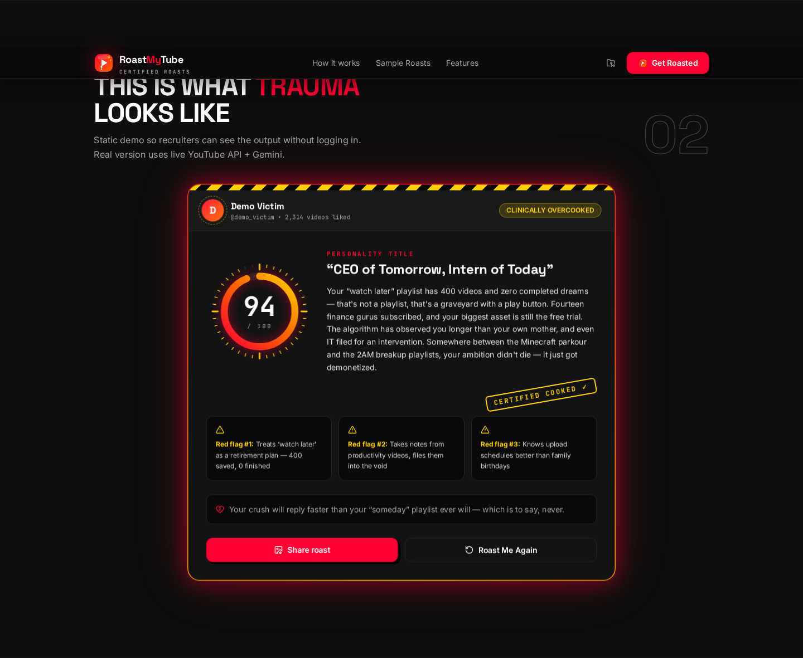
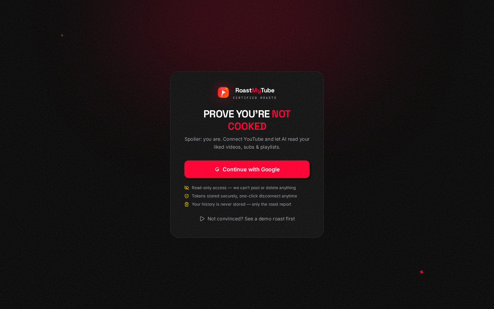

<div align="center">

# 🔥 RoastMyTube

**Connect your YouTube. Get brutally roasted by AI. Share the trauma.**

English + Hinglish roasts • Brain-Rot Score • Red-Flag detector • Shareable roast cards

[Live Demo](#-screenshots) • [Getting Started](#-getting-started) • [How It Works](#-how-it-works) • [API](#-api-reference)

</div>

---

## 📸 Screenshots

### Landing — Hero


### Live Sample Roast Card


### Login


---

## ✨ Features

| | |
|---|---|
| 🎯 **Real YouTube data** | Liked videos, subscriptions, playlists + channel stats via YouTube Data API v3 (5 quota units/roast) |
| 🤖 **3-level LLM fallback** | Groq `gpt-oss-120b` → `gpt-oss-20b` → Gemini Flash. Hinglish safety fallback included |
| 🌐 **EN + Hinglish modes** | Corporate-friendly savagery or Delhi-tapori elder-brother tone (Roman script, PG-13) |
| 📊 **Brain-Rot Score** | Animated SVG gauge (0–100) with ranks from *Enlightened Monk* to *Clinically Overcooked* |
| 🚩 **Red flags, channel executions, love-life predictions** | Painfully specific, never generic |
| 📤 **Share Studio** | Post (1200×675) / Square (1080×1080) / Story (1080×1920) cards in PNG, JPG, WebP, AVIF + native share |
| 🕵️ **Takeout God-mode** | Optional Google Takeout upload — parsed 100% in-browser, only aggregates reach the server |
| 🔐 **Privacy-first** | Read-only OAuth scopes, history never stored, one-click disconnect + history wipe |

## 🛠️ Tech Stack

- **Framework:** Next.js 16 (App Router) + React 19 + React Compiler
- **Language/Runtime:** TypeScript + Bun
- **Styling:** Tailwind CSS v4, shadcn-style primitives, Framer Motion, custom SVG (zero stock icons for the brand)
- **Auth:** Better Auth (Google OAuth + `youtube.readonly`, offline tokens, auto-refresh)
- **DB:** Neon Postgres + Drizzle ORM
- **AI:** Groq (OpenAI-compatible) with Gemini fallback, zod-validated JSON output
- **Export:** html-to-image + Canvas API for multi-format downloads

## 🚀 Getting Started

### 1. Prerequisites
- Bun 1.x, a Google Cloud project, Neon database, Groq + Gemini API keys

### 2. Google Cloud setup (5 min, one-time)
1. Enable **YouTube Data API v3** (APIs & Services → Library)
2. Create an **OAuth client (Web)** → add redirect URI:
   `http://localhost:3000/api/auth/callback/google`
3. OAuth consent screen → **Test users** → add your Gmail (testing mode = 100 users max; verification needed only for public launch)

### 3. Run it
```bash
cd frontend
cp .env.example .env.local   # fill real values (see table below)
bun install
bunx drizzle-kit push        # create tables on Neon
bun run dev                  # http://localhost:3000
```

### 4. Environment variables
| Var | Where |
|---|---|
| `DATABASE_URL` | Neon dashboard (pooled connection string) |
| `GOOGLE_CLIENT_ID` / `GOOGLE_CLIENT_SECRET` | GCP → Credentials |
| `BETTER_AUTH_SECRET` | `openssl rand -base64 32` |
| `BETTER_AUTH_URL` | `http://localhost:3000` (prod URL on deploy) |
| `GROQ_API_KEY` | console.groq.com (free, no card) |
| `GEMINI_API_KEY` | Google AI Studio (fallback) |
| `NEXT_PUBLIC_SITE_URL` | Prod URL (SEO/canonical) |

`.env.local` is gitignored — never commit it. Rotate any key that was ever pasted in chat.

## 🧠 How It Works

```
Login (Google + youtube.readonly)
  → 4 parallel YouTube calls (channels, subs ×2 orderings, likes, playlists)
  → Takeout aggregate merged in (optional, browser-parsed)
  → Groq 120b → 20b → Gemini chain with zod-validated JSON
  → Report saved to Neon → gauge + typewriter UI → Share Studio
```

**Quota math:** 5 YouTube units/roast of the free 10k/day pool ≈ 2,000 roasts/day. ~3k LLM tokens/roast ≈ 1,000 free Groq roasts/day.

## 🔌 API Reference

| Route | Auth | Description |
|---|---|---|
| `GET /api/youtube/profile` | ✅ | Normalized channel/subs/likes/playlists |
| `POST /api/roast` `{language?, takeout?}` | ✅ | Full roast report, saved to DB |
| `GET /api/roast/history` | ✅ | Last 10 roasts |
| `DELETE /api/roast/history` | ✅ | Wipe history |
| `DELETE /api/account/google` | ✅ | Revoke + disconnect YouTube |
| `GET /api/roast/demo?lang=` | ❌ | Mock report, no login needed |

Error codes: `unauthorized` (401) • `relogin` (401) • `quota` / `slow_down` (429) • `roast_failed` (502) • `empty` (200)

## 🗺️ Roadmap
- [ ] OG-image share cards (`next/og`)
- [ ] Roast battles (compare two channels)
- [ ] Leaderboard (highest Brain-Rot of the week)
- [ ] Google verification for public launch

## 👤 Author
**Made by [Rahul Sain](https://rahulxcode.vercel.app)** — full-stack developer building AI-powered SaaS.
Find me on [X](https://x.com/RahulSain714) • [LinkedIn](https://www.linkedin.com/in/rahulxcode/) • [GitHub](https://github.com/Anos714)

*Parody project. Not affiliated with YouTube or Google. Roasts are playful PG-13 — no templates were harmed.*
